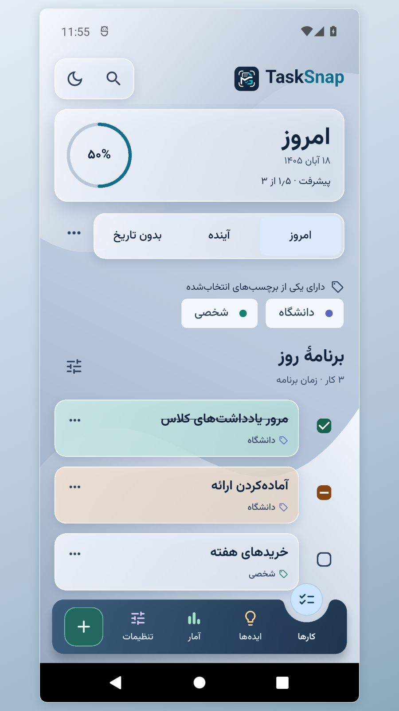
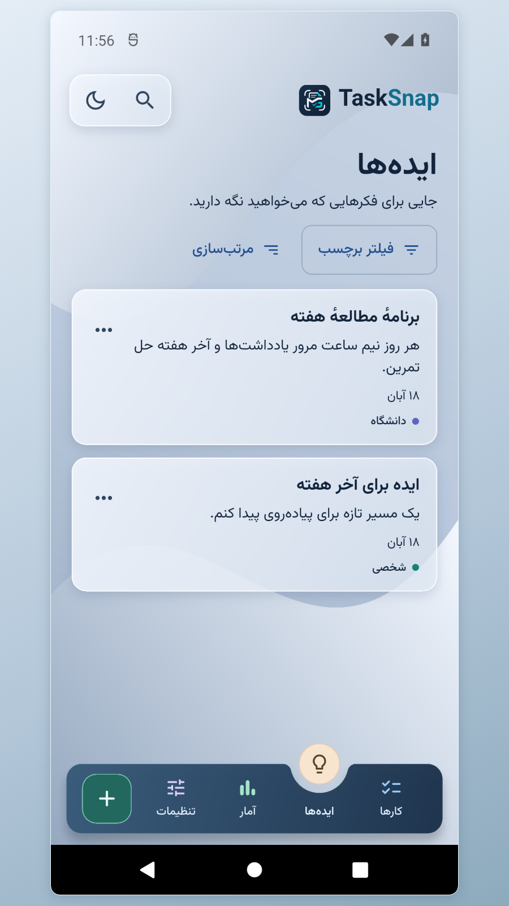
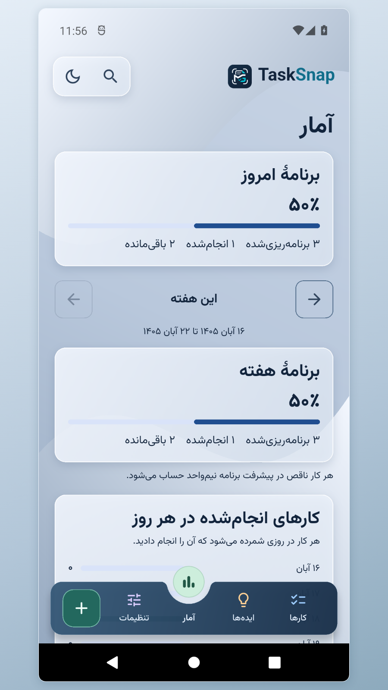

# تسک‌اسنپ

برنامه‌ریز اندروید برای ثبت کارها و ایده‌ها، تنظیم یادآور و دنبال‌کردن برنامهٔ روز.

من **محمد قربانی** هستم، سازنده و توسعه‌دهندهٔ تسک‌اسنپ. این برنامه را برای حل مسئله‌ای ساختم که خودم هر روز با آن روبه‌رو بودم. می‌خواستم کارها و ایده‌ها را همان لحظه ثبت کنم و بعداً سر فرصت مرتبشان کنم.

[English](README.md) · [صفحهٔ معرفی](https://mohammadghorbani-dev.ir/tasksnap/index.html) · [سیاست حریم خصوصی](https://mohammadghorbani-dev.ir/tasksnap/privacy.html)

  
  
  

تصاویر با کارها و ایده‌های نمونه ثبت شده‌اند.

## مطالعهٔ موردی

**طراحی.** کارهای امروز را از کارهای آینده و بدون تاریخ جدا کردم تا مشخص باشد در طول روز روی چه چیزهایی باید تمرکز کرد. وضعیت «ناقص» در محاسبهٔ پیشرفت نصف یک کار کامل حساب می‌شود. برنامه رابط فارسی و انگلیسی، چیدمان راست‌به‌چپ و چپ‌به‌راست و تقویم شمسی و میلادی دارد.

**مهندسی.** رابط را با Flutter ساختم، برای ذخیرهٔ داده روی دستگاه از SQLite استفاده کردم و آلارم، دسترسی به فایل‌ها و تقویم دستگاه را با Kotlin پیاده کردم. فایل پشتیبان شامل عکس و صداست و بازیابی ادغامی موارد تازه را اضافه می‌کند و رکوردهای موجود را حفظ می‌کند. اتصال Google Drive اختیاری است و از مجوز محدود فایل استفاده می‌کند.

**آزمون انتشار.** نصب نسخهٔ امضاشده روی Android 12، اجرای آفلاین، بازیابی فایل بدون ایجاد موارد تکراری و حفظ پیوست بررسی شدند. اتصال، ذخیره و بازیابی Google Drive هم با حسابی خارج از فهرست آزمونگران تأیید شد.

## وضعیت

نسخهٔ ۰٫۹٫۱ برای بررسی به مایکت و کافه‌بازار ارسال شده است. پیوند فروشگاه‌ها بعد از انتشار اضافه می‌شود. کد برنامه در مخزن خصوصی جداگانه نگهداری می‌شود.

در روند توسعه از ابزارهای مختلف، از جمله ابزارهای هوش مصنوعی، کمک گرفتم. [پورتفولیو و راه تماس برای همکاری](https://mohammadghorbani-dev.ir/contact).
