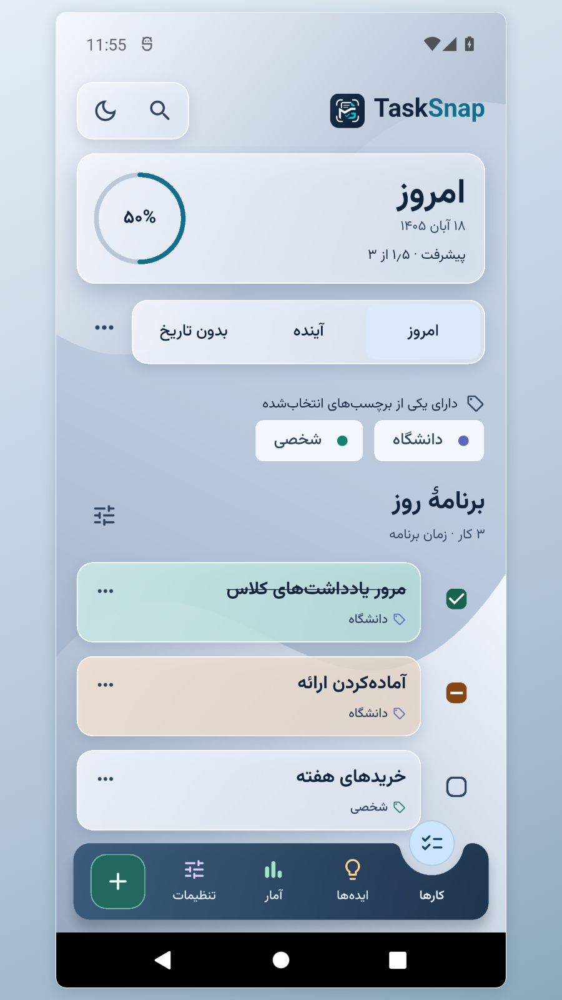
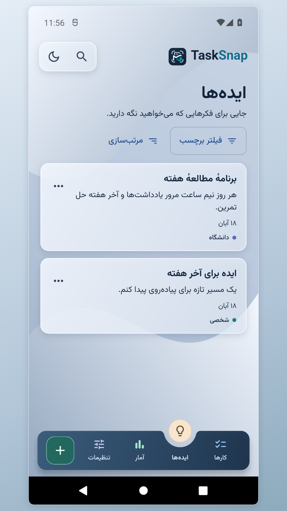
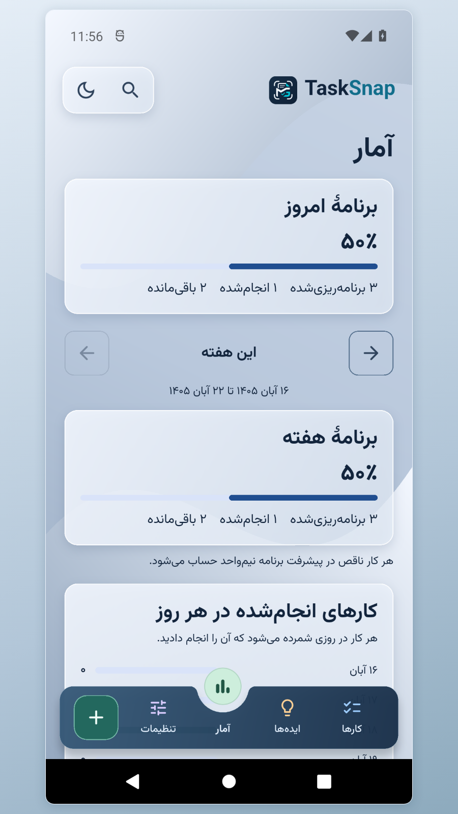

# TaskSnap

An Android planner for capturing tasks and ideas, setting reminders, and following through on daily plans.

I’m **Mohammad Ghorbani**, the developer behind TaskSnap. I built it around a problem I had myself: keeping track of everyday tasks and ideas without slowing down to organize them first.

[فارسی](README.fa.md) · [Product website](https://mohammadghorbani-dev.ir/tasksnap/index.html) · [Privacy policy](https://mohammadghorbani-dev.ir/tasksnap/privacy.html)

  
  
  

The screenshots use sample tasks and ideas.

## Product case study

**Design.** I separated today’s work from upcoming and unscheduled tasks so it is easy to see what needs attention now. Tasks can be open, partial, or completed. A partial task contributes half a point to progress. The Persian and English interfaces support right-to-left and left-to-right layouts and Solar Hijri and Gregorian calendars.

**Engineering.** I built the interface in Flutter, used SQLite for on-device storage, and integrated Android alarms, file access, and device calendars through Kotlin. Portable backups include photos and audio. Merge restore adds missing items and preserves existing records. Optional Google Drive backup uses limited file access.

**Release validation.** The signed candidate was installed on Android 12 and checked for offline startup, duplicate-safe restore, and attachment integrity. Google Drive authorization, backup, and restore were also verified with an account outside the test-user list.

## Status

TaskSnap 0.9.1 has been submitted to Myket and Café Bazaar for review. Store links will be added when available. Application source is maintained in a separate private repository.

## Development process

I built TaskSnap in stages, starting with quick task entry and daily planning. Using early builds on my phone helped me refine the task controls and reminder flow before adding attachments, backups, and calendar integration. I used technical documentation and Android development tools to check behavior across devices, and AI assistance to compare implementation options and review changes.

[Portfolio and project inquiries](https://mohammadghorbani-dev.ir/contact)
